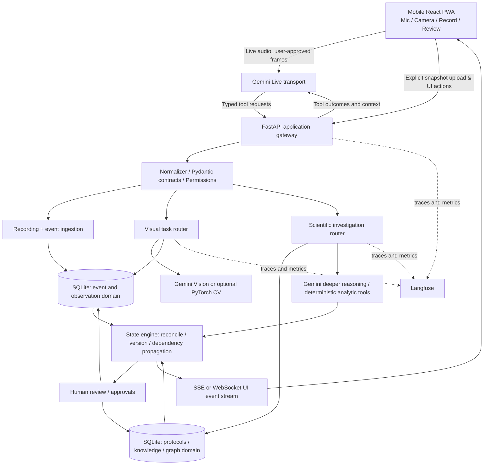

# LABMATE — Master Build Brief for Claude

**Project:** LABMATE — a hands-free, multimodal, state-aware laboratory research copilot  
**Origin:** UCL AgentVerse 2026, biotech / Gemini-focused hackathon  
**Audience:** Claude Code or another coding agent acting as lead engineer, plus five-person project team  
**Document type:** Consolidated conversation summary **and** implementation specification  
**Status:** Planning brief, **not** a claim that code, model access, tests, integrations, or deployment already work  
**Last discussion context:** 8 November 2026; the event submission deadline had previously been stated as **14:00 on 8 November 2026**. Verify this immediately. The earlier eight-hour schedule may no longer fit the time remaining.

---

## 0. START HERE — instructions to Claude

You are the implementation lead for LABMATE. **Inspect the existing repository and environment before making changes**: some of the Phase 1 work may already have been assigned to Codex. Do not overwrite working code, credentials, or teammate changes. Audit what exists; integrate and extend it.

Your goal is a **demonstrably working end-to-end product**, not an impressive but disconnected architecture. The critical sequence is:

> **Phone → explicit user-controlled microphone/camera → real Gemini Live conversation → typed tool call → locally persisted observation → application state update → visible live event feed → review/correction.**

Next, if time permits:

> **Protocol reconciliation → dependency/impact graph → selective Gemini deep investigation → specialist vision baseline → measured evaluations → optional generated explanatory media.**

**Operational priorities:**

1. **First check the real remaining deadline and repository state.** If less than five hours remain, execute the emergency critical path in §17, not the entire eight-hour roadmap.
2. **Ask for credentials before building a dependency around them.** Guide the user through entering them **locally** into `.env` / appropriate Google authentication. Never ask for keys in chat, commit them, or embed them in frontend code. Test small real calls early. Confirm the *actual provisioned* Gemini API surface and Live-compatible model, rather than trusting previously discussed model IDs.
3. **Run and test the real app.** Deliver executable source, startup scripts, a working local backend, a secure phone connection path, and a populated **local SQLite** database. Never label mocks as real API integration.
4. **Keep recording and visual transmission explicitly user-controlled.** The microphone and camera start off. Scientific recording starts only after the user presses **Record**. Camera opens only following an explicit user action; camera preview does **not** automatically stream frames to Gemini. Separate user conversation from persistence.
5. **Preserve scientific integrity.** Raw events are immutable; AI-derived measurements are labelled as proposed/unverified; approved protocol changes require a human; a recorded anomaly does not automatically establish a failed experiment.
6. **Design for teammate parallelism.** Provide stable typed contracts, sample records, well-scoped modules, and a diagnostic capability view. Let collaborators implement domain data, steering, vision, or pitch without modifying the core media transport.
7. **Instrument and evaluate before claiming superiority.** Compare a plain Gemini baseline to the system's specialist perception, state management, and verification on independently labelled cases.
8. **Use best-effort fallbacks.** If Live model availability, mobile HTTPS, image annotations, or specialist model training stalls, keep the core app functional, describe what is genuine versus mocked, and preserve integration interfaces.

**Do not spend the final hours on a custom agent framework, complex cloud infrastructure, retraining large models, or generated cinematic video while the live data stream is not working.**

### One-sentence product definition

**LABMATE is a mobile, hands-free lab copilot that listens and (when permitted) sees, converts observations into an auditable experimental record, compares them with planned protocols, propagates possible impacts through an experiment dependency graph, and brings in specialist analysis and human approval when needed.**

### One-sentence pitch

> **“Every experiment has a plan. Every experiment has a reality. LABMATE connects them, so research decisions remain evidence-grounded and reproducible.”**

### Suggested 20-second live demo

1. Researcher presses **Record**, then says: “I added 20 microlitres to sample B3.”
2. Gemini interprets speech and requests `propose_observation` through a controlled tool contract.
3. Backend persists the event and compares it with the sample protocol (demo expected value: 10 µL).
4. UI immediately flags **a reported deviation requiring review**, highlights B3 and dependent measurement/analysis nodes, and asks whether this was intentional.
5. Researcher approves/disputes the **recorded report**; original observation stays in the audit log. The model explains what is known, uncertain, and what may require rechecking.

All quantities in this storyboard are **synthetic example data**, not genuine experimental findings. **Approval of an observation is separate from deciding whether data should be included or excluded in an analysis.**

---

## 1. User goals and historical ideation — what changed and why

The team comprises **one primarily technical/orchestration engineer** and **four biology/computational biology students**. The technical engineer is experienced in agent orchestration, evaluation, tool contracts, Langfuse, dynamic agent topology, and production data pipelines, but does not want to spend limited hackathon time on training-heavy computational biology. The biology teammates are responsible for affirming the scientific bottleneck and selecting scientifically defensible use cases.

The biotech challenge was described as **“Make the path to patients faster”** by finding a genuine bottleneck and building an agent that makes it faster, cheaper, or fairer. Scientific credibility, rigorous evidence and databases/graphs matter to the judges. Sponsor-specific effectiveness matters: prefer a **deep Gemini application**, not a superficial combination of tools. Modal credits are available, but using Modal should not be compulsory.

Concepts considered:

- **REWIND / FAILFORWARD:** turn failed or negative research into an interactive, evidence-grounded investigation; investigate drug trial failures and resistance mechanisms. Strong story but broad for the time available, and AI research-assistant competition is substantial.
- **CellTrace Verify:** examine microscopy time series, track cells and investigate whether apparent findings survive measurement/segmentation corrections. Strong scientific visual/data link but substantial competition (TrackMate, CellProfiler, commercial imaging software, and emerging microscopy agents).
- **LABGUARD:** real-time lab logging, protocol deviation detection and human approval. Operationally useful; a number of existing ELNs and lab assistants already cover basic documentation, including hands-free voice features.
- **Precision oncology / Resistance Replay:** investigate acquired resistance, e.g. EGFR-mutated lung cancer, through curated molecular evidence. High science depth but too domain-specific and potentially large for the remaining build time.
- **LABMATE (chosen direction):** hands-free, multimodal, state-aware lab assistant applicable across lab experiments; the biology team will supply the domain-specific protocol and sample information.

**Important competitive positioning:** Do **not** claim to have invented voice-enabled ELNs, AI laboratory note-taking, microscopy tracking, or AI scientific hypothesis generation. Related products and research already exist. **The proposed differentiator is the combined, independently verifiable system:** live observations + typed state + protocol reconciliation + dependency graph + specialist tool routing + source provenance + human approval.

**Patient-pathway connection:** bad or fragmented preclinical records may force repeated work or weaken interpretation, potentially slowing drug discovery and treatment development. Present this as a plausible **upstream research bottleneck**, not as proven clinical time/cost savings. A biology teammate should source and qualify the downstream impact evidence.

---

## 2. Hard requirements, priorities, and exclusions

### P0 — must work

- Mobile-first app accessible from the user's phone, with a laptop running the backend and **local SQLite**.
- Real bidirectional **Gemini Live** audio conversation if model credentials support it; real API verification, no simulated successful connection.
- Explicit camera **Open / Close** with correct browser media-track cleanup.
- Explicit microphone **Enable / Mute**; disabled by default.
- Explicit **Start Recording / Stop Recording** for experimental logging; off by default and server-authoritative.
- Clear separation of **camera preview**, **frames sent to Gemini**, and **saved snapshots**.
- A live feed showing what scientific events are **pending, persisted, or rejected**, with timestamps and structured payloads.
- At least one genuine spoken-to-tool-to-database-to-UI round trip.
- Basic image recognition using a real Gemini vision-capable endpoint, either live frames when deliberately enabled or explicit snapshot analysis; show structured output and uncertainty.
- Stable API contracts, raw event persistence and readback after restart.
- Secure phone-access mechanism that satisfies browser microphone/camera secure-context requirements and protects any exposed endpoints.
- One real, seeded synthetic experiment and minimal protocol rules to demonstrate a deviation.

### P1 — strongest “not a wrapper” proof

- Persistent, versioned **scientific state engine** not dependent on Gemini's conversation history.
- Deterministic expected-vs-observed protocol reconciliation.
- Dependency traversal: which samples, measurements, and interpretations are potentially affected by an observation.
- Human review controls; no automatic authoritative record overwrite or unapproved plan changes.
- Selective escalation from Gemini Live into deeper Gemini reasoning/tools.
- Optional **specialist PyTorch perception** adapter with a bubble-detection/recognition benchmark if representative data exist.
- Langfuse tracing and reproducible evaluation tests with actual results.
- UI graph/timeline linked to source events and their uncertainty/review status.

### P2 — stretch / after stable MVP

- Bayesian next-experiment suggestions using explicit data, likelihoods, and assumptions.
- Video-generation/narration based on **verified scientific state**, rather than treating generative media as experimental evidence.
- Modal-hosted specialist inference if it truly benefits latency or compute and credits/access are present.
- Broader university knowledge/research corpus; more experimental types; multi-user research collaboration.

### Explicit non-goals for this sprint

- A regulatory-grade clinical/ELN system; real patient-data ingestion; autonomous treatment recommendations.
- High-fidelity molecular simulation or prediction of patient response from generated video.
- Continuous all-frame archival of live video, exact real-world volume measurement from images, or high-speed action detection from a low-FPS Live camera feed.
- Building two separate database servers, a complicated graph infrastructure, a custom autonomous swarm, or a large bespoke Bayesian engine before the app works.

---

## 3. End-to-end system architecture

The user's preferred conceptual architecture has **two database divisions**, but implement them as **two logical domains in one SQLite database** for the hackathon:

- **Observation/recording domain:** what was spoken, shown, reported, extracted, corrected, or approved, with source IDs and timestamps.
- **Scientific knowledge/experiment domain:** protocol versions, steps, samples, experimental conditions, constraints, observations, measurements, related prior cases and dependency graph edges.

The authoritative boundary is **untrusted proposed observation vs approved scientific state**, not merely “model vs database.”



### The fast and deep loops

**Fast loop** (low latency): Live speech/vision interpretation, fetching current step, proposing an observation, retrieving latest observations, acknowledging persisted results.

**Deep loop** (selective): protocol contradictions, uncertainty, questions about downstream effect, related prior cases, scientific plan-change proposals, quantitative tool calls. Invoked by deterministic escalation policy, rather than on every utterance.

**Control layer** (non-LLM): validates schemas and recording state; compares expected and observed values; traverses graph dependencies; prevents unauthorised mutations; performs numeric calculations; checks idempotency; persists immutable events; returns factual tool responses.

### Recommended code stack

| Concern | Default | Why |
|---|---|---|
| Frontend | React + TypeScript + Vite + Tailwind, PWA | Mobile-first, easy to prototype |
| Media | Browser `getUserMedia`; Live API WebSocket | User-controlled camera/mic, real streaming |
| Backend | FastAPI + Pydantic | Typed contracts, tools, events |
| Database | SQLite + SQLAlchemy, WAL mode | Local, simple, sufficient for demo |
| Media storage | Local `data/media/` + hash/path metadata | Do not put blobs directly in SQLite |
| Application updates | SSE (simple) or WebSocket | Visible persisted state feed |
| Gemini integration | Official `google-genai` SDK | Confirm current model/API details |
| Image understanding | Native Gemini Vision | Phase 1 support |
| Optional visual counting | PyTorch / Ultralytics segmentation or OpenCV | Test if native Gemini isn't precise enough |
| Deeper reasoning | Sponsor-provisioned Gemini reasoning model | Selective scientific investigation |
| Observability | Langfuse SDK if already available, otherwise lightweight structured JSON traces with adapter | Tracing should not block MVP |
| Optional compute | Modal SDK behind provider interface | No need for GPU just to call Gemini APIs |
| Frontend scientific view | React Flow / simple SVG and charts | Explore graph and provenance |

**Do not assume** previously discussed names such as `gemini-4-argon`, `gemini-3.8-live`, or `gemini-omni` are available on this exact account/API surface. Run model discovery and an authenticated smoke test. Distinguish Gemini Developer API from Vertex AI/GCP; choose either compatible ephemeral client tokens or a backend Live relay based on the provisioned authentication. No API key in browser bundles.

---

## 4. Precise privacy, recording, and media semantics

These are separate booleans/state machines:

```text
app_backend_connected
gemini_live_connected
microphone_enabled
camera_preview_open
camera_frames_shared_with_gemini
experiment_recording_active
snapshot_analysis_in_progress
science_investigation_in_progress
```

**Initial state:** microphone OFF; camera OFF; camera-sharing OFF; experimental recording OFF.

**Explicit recording contract:** User only starts scientific recording by pressing **Record**. A model may suggest starting, but cannot start it autonomously. All persistent observation records are protected by a **backend recording-active check**. A disconnected client or ended session must not leave recording active indefinitely. Introduce a session expiry/heartbeat and reconciliation on reconnect.

**Live conversation vs saved evidence:** The user can converse with Gemini with the experiment recorder OFF. In that state, the app may show ephemeral transcript text on screen but must **not store transcript/observations locally in the experiment log**. Provider-side data handling is governed separately by the selected Google service terms; do not promise that no provider logs/retention exist. Diagnostic logs must not inadvertently store conversation contents.

**Camera** requires explicit action. Opening preview does not automatically stream frames or persist images. Closing the camera stops browser media tracks and scheduled frame sends. A spoken request to open the camera can display a confirmation, but browser permissions may require a real user gesture. Avoid covert activation.

**Snapshot analysis** requires user action and informs the user whether an image is being sent to the model. Saving the screenshot, derived description or scientific observation should require active experiment recording and explicit save behaviour. A preview/inspection performed while recording is OFF should not silently persist anything.

**Raw audio/video files** are not automatically stored in Phase 1. Persist only approved final transcript segments, typed observation events and explicitly saved media, with links/hashes.

**Security for phone access:** `getUserMedia` generally requires HTTPS/secure origin on a phone. `localhost` on the laptop does not make its LAN IP a secure origin on the phone. Use an authenticated HTTPS tunnel or properly configured trusted local HTTPS. Protect every externally accessible API and event endpoint with a session token/auth; do not expose the SQLite database or debug data publicly. If a tunnel requires user login, provide exact steps. Keep API secrets server-side; limit CORS origins, upload size, and rate of model calls.

---

## 5. UI specification (mobile-first)

### Screen 1 — Live Lab cockpit (primary judge demo)

- LABMATE header and status pills: backend connected, Gemini connected, microphone, camera, recording.
- **Connect / Disconnect Gemini** control; **Mic Enable / Mute** control; **Start / Stop Recording** control with unmistakable active indicator.
- **Open / Close Camera**; preview; **Share frames with Gemini** independently; **Capture Snapshot**; **Analyse**; upload from photo library as fallback.
- Live visual/audio transcript and model reply, with distinction between ephemeral conversation and saved observation.
- Current experiment, active protocol step, sample, and pending review count.
- Incoming event list: timestamps, modality, extraction status, structured JSON, source ref, pending/committed state; use optimistic UI only with a *pending* label before backend confirmation.
- Large, accessible action buttons for hands-free work; readable contrast, keyboard support and clear spoken confirmations.

### Screen 2 — Experiment state

- Timeline of events and protocol steps.
- Sample/step/measurement graph, where dependencies are shown as links.
- Highlight any reported deviation and potentially affected downstream nodes.
- Node detail: originating observation, relevant protocol, tool/model, human reviewer, uncertainty, linked source image/transcript, audit history.

### Screen 3 — Review and corrections

- Original observation vs expected protocol value.
- Approve / Dispute / Correct actions (with reasons).
- Explicit separation of confirming a recorded fact, accepting an intentional protocol deviation, and excluding a measurement from analysis.
- Original records remain immutable; corrections create linked events and new state versions.

### Screen 4 — Diagnostics (development only)

- API, WebSocket, Live model, camera/mic permission, recording, event-stream and database statuses.
- Last successful DB write and recent non-sensitive errors.
- Enabled capabilities (`live`, `vision`, `specialist_cv`, `deep_reasoning`, `modal`, `langfuse`).
- Developer inspector to show real tool requests/responses and a redacted scientific state JSON view. Do not show secrets.

PWA is preferred over native iOS/Android for hackathon speed. Mobile browsers can suspend camera/mic in background or on lock-screen, so demo with app foregrounded.

---

## 6. Suggested repository structure and ownership boundaries

```text
labmate/
├─ frontend/
│  ├─ src/
│  │  ├─ components/     # CameraPanel, AudioPanel, EventFeed, ReviewPanel
│  │  ├─ pages/          # LiveLab, Experiment, Reviews, Diagnostics
│  │  ├─ hooks/          # useMediaDevices, useLiveSession, useEventStream
│  │  ├─ services/       # typed API client, transport
│  │  └─ state/          # connection/recording UI state
│  └─ public/            # manifest/icons
├─ backend/
│  ├─ app/
│  │  ├─ main.py
│  │  ├─ config.py
│  │  ├─ contracts.py
│  │  ├─ api/
│  │  ├─ live/           # Gemini Live transport / tool callback mapping
│  │  ├─ db/             # SQLAlchemy, migrations/schema initialization
│  │  ├─ events/         # append-only observations / SSE
│  │  ├─ state/          # protocol reconciliation, dependency traversal
│  │  ├─ science/        # investigation and policy modules
│  │  ├─ vision/         # GeminiVisionProvider, SpecialistVisionProvider
│  │  └─ observability/  # Langfuse provider / redacted tracing
│  └─ tests/
├─ science/
│  ├─ experiment_seed.json
│  ├─ scientific_cases.json
│  ├─ steering.md
│  └─ references.md
├─ evals/
│  ├─ eval_cases.json
│  ├─ vision_test/
│  └─ evaluate.py
├─ pitch/
├─ scripts/            # setup.ps1, start.ps1, test.ps1, optional POSIX
├─ docs/
│  ├─ ARCHITECTURE.md
│  ├─ API_CONTRACTS.md
│  ├─ PHONE_SETUP.md
│  └─ NEXT_PHASE.md
├─ .env.example
├─ .gitignore
├─ requirements.txt / pyproject.toml
└─ README.md
```

If the repo already has a different structure, **adapt rather than rebuild**. Keep the API contracts as the one shared integration surface and minimise parallel edits to transport code.

---

## 7. Contracts to freeze early

Use Pydantic on backend and generated or manually matching TypeScript types on frontend. Define status/error shapes consistently. Include UTC timestamps, stable IDs, `schema_version`, `idempotency_key`, and expected state version for protected mutations.

### Essential API

| Method | Endpoint | Result |
|---|---|---|
| GET | `/health` | App/database readiness, version (no secrets) |
| GET | `/capabilities` | Configured and verified integrations |
| GET/POST | `/experiments` | List/create synthetic experiments |
| GET | `/experiments/{id}` | Current protocol and state |
| POST | `/recordings/start` | Server creates active recording session |
| POST | `/recordings/{id}/stop` | Stops experimental logging |
| GET | `/recordings/{id}` | Authoritative state |
| POST | `/observations/propose` | Validates and persists a **pending** source-linked event |
| GET | `/observations?experiment_id=...` | Paginated events |
| POST | `/observations/{id}/review` | Human review/correction event |
| POST | `/vision/analyse` | Snapshot to Gemini/optional specialist CV; structured result |
| POST | `/investigate` | Optional deeper scientific investigation |
| GET | `/events/{experiment_id}/stream?after_sequence=...` | SSE or equivalent persisted state stream |
| WS | `/ws/live` | Optional backend relay for Gemini Live |

**Important:** public external endpoints need authentication; `GET /health` can be restricted as needed. If using direct client → Gemini ephemeral-token sessions, backend still owns tool validation and persistence.

### Model-facing tools

```python
get_experiment_context(experiment_id: str) -> ExperimentContext
get_recent_observations(experiment_id: str, limit: int = 10) -> list[Observation]
get_recording_state(session_id: str) -> RecordingState
propose_observation(experiment_id: str, session_id: str,
                    source_event_id: str, observation: ObservationInput,
                    idempotency_key: str) -> ObservationWriteResult
request_visual_analysis(image_id: str, question: str) -> VisionResult
find_related_evidence(experiment_id: str, query: str) -> EvidenceSearchResult
analyse_discrepancy(observation_id: str) -> DiscrepancyResult
propose_plan_change(experiment_id: str, change: PlanProposal) -> PlanProposalResult
```

For Phase 1 implement first five; others may return clearly declared `not_configured` until ready. **The model can propose observations and plans, not approve itself or mutate approved protocol versions directly.** Do not tell the user a record was saved until the tool confirms DB commit.

### Example observation event

```json
{
  "schema_version": "1.0",
  "observation_id": "obs_0001",
  "experiment_id": "exp_001",
  "recording_session_id": "rec_001",
  "source": {
    "modality": "speech",
    "source_event_id": "audio_segment_010",
    "captured_at": "2026-11-08T09:12:00Z",
    "media_id": null
  },
  "observation": {
    "type": "volume_added",
    "subject_id": "B3",
    "value": 20,
    "unit": "uL",
    "reported_by": "researcher"
  },
  "method": {
    "provider": "gemini_live_extraction",
    "model": "ACTUAL_VERIFIED_MODEL_ID"
  },
  "status": "pending_review",
  "idempotency_key": "event_010_volume_B3"
}
```

### Example scientific context seed

```json
{
  "schema_version": "1.0",
  "experiment_id": "exp_001",
  "name": "Synthetic laboratory workflow demo",
  "protocol": {
    "protocol_id": "proto_001",
    "version": 1,
    "steps": [
      {"id": "step_003", "description": "Prepare B3", "sample_id": "B3"}
    ]
  },
  "samples": [{"id": "B3", "condition": "demo_condition"}],
  "constraints": [
    {"id": "con_001", "step_id": "step_003", "subject_id": "B3",
     "field": "volume_added", "operator": "equals", "value": 10, "unit": "uL",
     "source": "synthetic_demo_protocol"}
  ],
  "dependencies": [
    {"source_id": "B3", "target_id": "measurement_B3", "type": "may_affect"},
    {"source_id": "measurement_B3", "target_id": "analysis_001", "type": "input_to"}
  ],
  "related_evidence": []
}
```

### Example specialist vision result

```json
{
  "schema_version": "1.0",
  "image_id": "img_001",
  "task": "bubble_detection",
  "provider": "specialist_pytorch_v1",
  "image_width": 1280,
  "image_height": 720,
  "detections": [
    {"label": "candidate_bubble", "bbox_xyxy": [110, 200, 180, 270], "score": 0.82}
  ],
  "count": 1,
  "units": "pixel_coordinates",
  "review_required": true,
  "model_version": "actual_checkpoint_or_not_configured"
}
```

All above examples are *illustrative*, not model outputs or real test observations. A detection score is not necessarily a calibrated probability.

---

## 8. Local database implementation

Use SQLAlchemy/SQLite. Consider WAL mode, one authoritative transaction for write + sequence assignment, and simple migrations or reproducible schema bootstrapping. Use **append-only event records** and versioned materialised experiment state.

Suggested tables:

**Observation domain**

- `experiments(id, name, status, created_at, current_protocol_version)`
- `recording_sessions(id, experiment_id, started_at, stopped_at, expires_at, status)`
- `observation_events(id, experiment_id, session_id, sequence_number, occurred_at, ingested_at, source_modality, event_type, payload_json, model_id, status, source_ref, idempotency_key UNIQUE)`
- `observation_reviews(id, observation_id, action, correction_json, actor, reason, created_at, previous_event_id)`
- `media_assets(id, experiment_id, local_path, sha256, mime_type, created_at, source_event_id)`
- `analysis_runs(id, experiment_id, input_refs_json, method_version, output_json, status, created_at)`

**Scientific domain**

- `protocol_documents(id, experiment_id, version, content_json, created_at, approved_by)`
- `protocol_steps(id, protocol_id, step_order, instruction_json)` or represent inside versioned protocol JSON for speed
- `scientific_entities(id, experiment_id, entity_type, label, properties_json)`
- `scientific_relationships(id, experiment_id, source_entity_id, target_entity_id, relationship_type, evidence_ref)`
- `scientific_constraints(id, experiment_id, protocol_version, subject_id, field, rule_json, source_ref)`
- `plan_proposals(id, experiment_id, base_version, proposed_changes_json, status, created_at, reviewer_id)`

Indexes on experiment, session, sequence and entity relationships. Keep event log immutable (reviews/corrections are new records). Persistent observations must not be written while `recording_session.status != active` (or expired). Idempotent tool calls should return prior committed event, not insert twice.

### State-machine proposal

```text
OBSERVING
  → OBSERVATION_PROPOSED
     → RECONCILING
       → CONSISTENT → PENDING_REVIEW → REVIEWED
       → DISCREPANCY → INVESTIGATION_REQUIRED
                        → PLAN_CHANGE_PROPOSED
                        → HUMAN_REVIEW
                        → APPROVED / REJECTED
```

Model suggests; backend validates legal transitions. A disputed record remains visible. Downstream analyses should be marked `review_required` or `stale`, not silently recalculated in ways that rewrite previous published findings.

### Dependency traversal

When a reported deviation references `sample_B3`, walk graph edges from sample → measurement(s) → analysis run(s) → interpretation(s). Produce a list of potentially impacted nodes and explain *why* each is flagged, with a path of relationship IDs. This is an **impact-for-review** graph, not proof of causal effect.

---

## 9. Actual data flows to implement

### A. Live conversation and recording

1. User explicitly enables mic and connects Live.
2. Client sends audio using authenticated direct ephemeral Live route or a backend relay.
3. Gemini produces text/audio and, when appropriate, `propose_observation` tool call.
4. Backend validates active recording and the typed event; rejects or records with persistent sequence ID.
5. Tool response returns DB-confirmed status; Gemini accurately acknowledges success/failure.
6. UI subscribes to SSE and renders only committed events as saved; uses sequence cursor to catch up after reconnect.
7. If recording is OFF, the same conversation may occur, but experimental persistence is denied.

### B. Snapshot + native Gemini vision

1. User opens camera; preview starts, but sharing and recording remain independently OFF.
2. User explicitly captures/analyses an image.
3. Backend invokes real vision-capable Gemini model with structured-output schema when available.
4. Display result with limitations; report uncertain counts as estimates.
5. Only if experiment recording is ON and save is requested, store media reference/hash and proposed visual observation; otherwise keep ephemeral.
6. Camera Close stops browser tracks and scheduled frame transmissions.

### C. Specialist visual perception (optional)

1. User requests a **quantitative** visual task, e.g., candidate bubbles in microfluidic imagery.
2. Task router chooses configured specialist detector; otherwise use native Gemini vision and label limitations.
3. Detector receives high-resolution snapshot (not low-FPS Live video), returns boxes/masks/counts and model version.
4. Deterministic verifier checks coordinate validity, duplicates, format and image quality.
5. Gemini explains the results **relative to the protocol**, not as independent proof that an experiment failed.
6. Save source reference and pending review event only under active recording.

### D. Plan change (P1)

1. Researcher asks: “Should I change the next step based on this observation?”
2. Gemini Live invokes deep investigation tool with current state version.
3. Orchestrator retrieves scientific context and related evidence; optionally invokes analysis, relevant literature or Bayesian decision tool.
4. Return a typed proposal stating evidence, assumptions, unknowns and affected steps.
5. Human approves/rejects from UI; backend enforces `expected_protocol_version` and records new version only on approval.

### E. Optional video/audio explanation (P2)

Generate a **narrated experimental replay** from **verified event + mechanism graph state**, not from unsupervised extrapolation. Distinguish:

- **Source footage:** real evidence (if explicitly captured and stored).
- **Rendered structured animation:** deterministic UI representation of logged steps/measurements.
- **AI-generated clip:** illustrative, scientifically reviewed, clearly labelled; never mistaken for observed results or a predictive biological simulation.

For judges, live state changes and evidence drilldown are more reliable than generating a new clip during a 20-second demo. Pre-generate one illustration only if the core works and access permits.

---

## 10. What “not a wrapper” means technically

Simply adding a database, another model, or multiple API calls around Gemini does not establish meaningful originality. The test is whether LABMATE performs reproducible functions Gemini **cannot enforce alone**:

1. **State independence:** A model restart or hallucination does not erase experiment history; all authoritative state persists in versioned DB records.
2. **Scientific constraints:** Backend checks planned vs reported values deterministically, including unit and sample-ID validation.
3. **Dependency semantics:** Structured graph links observations to affected measurements/analyses and can explain the dependency path.
4. **Specialised quantification:** A domain model can provide measurable detection/counting performance superior to native generic vision *on a tested dataset*, if evidence supports it.
5. **Tool routing and escalation:** Cheap/live operations stay fast; ambiguous or scientific decisions trigger richer investigation and/or human review.
6. **Human authority:** The AI cannot approve its own protocol amendments or remove inconvenient source records.
7. **Auditability:** Each claim and action has a source ref, model/tool version, timestamp, review history and testable provenance.

### Strongest judge interaction

A judge challenges a recorded observation; LABMATE revises its current interpretation, shows which other nodes depended on the challenged record, and keeps the original observation visible. This makes the intelligence and state constraints *visible* rather than merely claimed.

---

## 11. Vision research: native Gemini vs simple PyTorch bubble detector

The team discussed a **small PyTorch-trained detector/segmenter** for bubbles or other visually subtle lab features, as a way to improve fine-grained recognition. This **must be tied to the biologists' real selected setting**. For example, bubbles in microfluidic channels may indicate incomplete filling or flow obstructions requiring review; in other assays bubbles may themselves be the signal. Don't conflate uses.

### Feasible implementation

- First select a small collection of representative, ethically usable images and independently annotated ground truth.
- **Fastest route:** fine-tune a small pretrained detector/segmenter (e.g., PyTorch-backed Ultralytics) or reuse a compatible checkpoint; **do not train a CNN from scratch** unless team explicitly decides to do so.
- If segmentation masks are relevant to bubble area and shape, prefer segmentation. If only count/locations matter, object detection may suffice.
- Expose `VisionProvider.analyse_image(image, task) -> VisionResult`, with `GeminiVisionProvider` and `SpecialistVisionProvider`. Optional `ModalVisionProvider` must be nonblocking when disabled.
- Output boxes/masks in explicit coordinate system, scores, labels, count, source image ID and checkpoint hash/version; optionally an annotated preview.
- No inference model yet? Return `not_configured` honestly and keep native vision functional.

### Scientific limits

- Native Gemini can identify broad objects, read visible displays and estimate counts; **it is not a calibrated quantitative instrument**. Fine bubbles, overlapping transparent objects, fast pipetting and exact volumes are particularly challenging.
- Typical Live video frame sampling is too coarse for reliably verifying subsecond pipetting actions. Use dedicated higher-resolution snapshots or recorded data with appropriate frame rate when needed.
- Bubble datasets from boiling/reaction systems may not transfer to biomedical microfluidics; performance must be established on *representative held-out images* before making biomedical accuracy claims.

### Evaluation setup

Compare on **the same held-out independent annotations**:

- **A. Native Gemini:** image → prompted count/coordinates/uncertainty.
- **B. Specialist PyTorch:** image → detections and counts.
- **C. LABMATE workflow:** selected detector → validation → protocol context → interpretation and review state.

**Don't conflate metrics:** A versus B tests perception; C tests end-to-end scientific workflow.

| Metric | Definition / rationale |
|---|---|
| Count MAE | `mean(abs(predicted_count - labelled_count))`; easy to explain quantitative error |
| ±1 count accuracy | Fraction of images within one bubble of labelled count; pragmatic tolerance |
| Detection precision/recall | Match predicted objects with labels under documented IoU/centre-distance rule |
| False positives on no-bubble controls | Avoid excessive interruptions |
| Latency | End-to-end image submission → usable result; report p50/p95 when enough trials |
| Provenance completeness | Fraction of stored claims with valid image/source and model-version link |
| Human escalation rate | How often a suspicious or ambiguous result requests review appropriately |

For a small hackathon dataset (e.g. 15–20 manually labelled test images), label results as **proof of concept**, not statistically representative. If training occurred, ensure test images never appeared in training or tuning. Define ground-truth annotation rules in advance and record uncertain/ambiguous cases.

### Relevant reference leads from earlier discussion (verify before citation)

- Bubble/microfluidics literature discussed: smartphone microfluidic immunoassays using automated bubble handling and later bubble-based assay quantification. Do not treat those findings as specific evidence for a new detector until the scientific team checks the papers.
- Ultralytics PyTorch training and segmentation docs: <https://docs.ultralytics.com/>.
- Candidate public bubble datasets were considered (BubbleID, reactor/boiling-image sets); **licence, availability and domain match must be verified**.

---

## 12. Optional Bayesian recommendation engine

**Lower priority.** If the biology team can define a compact experimental dataset and a clear probabilistic question, add a separate numeric tool for proposing *which experiment could most reduce uncertainty*.

Possible approaches:

- Beta–Binomial for clearly binary outcomes.
- Bayesian normal model or Gaussian-process/active-learning approach for continuous response data (only with appropriate assumptions and enough data).
- Return predictive uncertainty, expected information gain and assumptions. Avoid claims of scientifically optimal treatment/clinical decisions.

Gemini should parse the request, call the numeric model with typed data, and explain the result with qualifications; **do not have Gemini invent Bayesian numbers**. If lacking enough data, abstain and mark the module a future extension.

---

## 13. Langfuse, trace privacy, and evaluation plan

Langfuse is an observability aid, **not the authoritative laboratory audit log**. Use it to track model decisions, tools, prompts, latency, errors, cost, and eval results. The actual observation/event history belongs in the local application DB.

Suggested trace spans:

```text
live_interaction
  → intent_or_tool_selection
  → propose_observation
    → validate_recording_state
    → validate_schema
    → persist_event
    → reconcile_protocol
    → propagate_dependencies
  → optional_vision_analysis
  → optional_scientific_investigation
  → user_review_request
```

Record `session_id`, `experiment_id`, prompt/model versions, tool name, evidence IDs, token/cost/latency where available, outcome status, and error taxonomy. **Avoid collecting raw microphone/video or sensitive full transcripts in Langfuse by default**. Use redaction and structured summaries. If self-hosted Langfuse isn't already running, don't spend core hours deploying its full DB/service stack; use hosted Langfuse if acceptable or a local JSON trace exporter behind the same adapter.

### Mandatory evaluation arguments to explain to judges

| Metric | Why chosen | Ground truth / oracle |
|---|---|---|
| Observation field accuracy | Wrong sample/unit/value corrupts experiment logs | Human-labelled spoken/image scenarios |
| Protocol deviation precision and recall | Must catch true differences without annoying false alerts | Biology-authored synthetic protocol cases |
| Dependency propagation precision/recall | Direct scientific effect of model state architecture | Expected graph reachability from seeded edges |
| Approval enforcement | Essential scientific integrity, not prompt compliance | Attempted unauthorised mutation tests; target zero commits |
| Provenance completeness | Findings must be independently inspectable | Referential integrity and human source checks |
| Appropriate abstention | Avoid hallucinated certainty when visual evidence is insufficient | Ambiguous and adversarial test cases |
| Interaction latency | Hands-free workflows should not impede researchers | Measured round-trip latency, not estimates |
| Vision count MAE/precision/recall | Quantitative perception must be independently validated | Annotated held-out image set |

### Baseline/ablation comparisons

- **A. Plain Gemini baseline:** receives protocol/context and observation; outputs natural language/JSON without state engine.
- **B. Gemini + deterministic state/reconciliation:** same inputs, validated tool calls and persistent context.
- **C. LABMATE full flow:** B + selective scientific investigation + specialist CV when available + human approval.

Run identical cases where possible and record time/cost penalties along with accuracy gains. Do not claim improvement when data don't support it. Present failure cases honestly. Include at least one malicious/erroneous attempt to approve a change without human authorization and ensure it fails at the backend, regardless of model wording.

---

## 14. Sponsor tools and credits available in the conversation

Organiser message quoted:

- **Canva:** <https://canva.com/redeem/AGENTVERSECANVA> (presentation design).
- **Modal:** roughly **$50 each**; organiser provided <https://modal.fillout.com/t/qMXCmRGseUus?code=7VS-G8J-QCU>.
- **Gemini + GCP:** credits sent to the email used for event application; redeem once with that email. **Amount and exact API model entitlements were not specified in the message.**
- The full setup guide, morning deck and Gemini how-to were said to be on Builderbase.
- Organisers warned to set **GCP budget alerts** and stop unused Modal apps; unattended compute can burn credits.

**The finance and robotics starter kits in the organiser message are other tracks, not mandatory biotech architecture.** Don't deploy MuJoCo/Isaac Sim, GPU jobs or the finance kit for LABMATE. Modal may be used later for specialist CV computation but is optional.

### Model and API capability assumptions

Some earlier discussion cited Gemini Argon, Live, and video-generation model labels with specific version numbers. These could be preview/event-specific, have changed, or differ by endpoint. Claude must **verify actual provisioned model IDs** via documentation and an authenticated request, and report whether each function was tested. Do not hardcode unverified model names or assume generation credits automatically cover every service.

Official reference starting points:

- Gemini API docs: <https://ai.google.dev/gemini-api/docs>
- Gemini Live docs: <https://ai.google.dev/gemini-api/docs/live>
- Google Gen AI Python SDK: <https://googleapis.github.io/python-genai/>
- Modal docs: <https://modal.com/docs>
- Langfuse docs: <https://langfuse.com/docs>
- FastAPI docs: <https://fastapi.tiangolo.com/>
- Browser media security: <https://developer.mozilla.org/en-US/docs/Web/API/MediaDevices/getUserMedia>

If external docs are unavailable, rely on installed SDK signatures/examples and note what remains unverified.

---

## 15. Five-person team responsibilities

The engineering owner should not be expected to code all parallel specialist work. Each person owns deliverables and an interface rather than editing a shared full-stack implementation at random.

| Role | Owner profile | Main deliverable | Integration contract |
|---|---|---|---|
| **1. Integrator / architecture** | User, technical engineer | Working React PWA, FastAPI, Live Gemini, API tools, local event stream, DB integration, merges | `contracts.py`, `/api`, Live transport, app launch scripts |
| **2. Scientific data / graph** | Biology/computational biology | Scientifically credible synthetic experiment, protocol, constraints, entities, dependencies, related cases | `science/experiment_seed.json`, `science/scientific_cases.json`, `references.md` |
| **3. Specialist vision + quantitative evals** | Computational biology | Representative bubble/object image set, baseline PyTorch inference or compatible fallback, native Gemini comparison | `vision/analyse_image()` response schema, `evals/vision_test/` |
| **4. Scientific steering + QA** | Biology/computational biology | Instructions for when to log/warn/abstain/escalate/review; ground-truth scenarios; verify scientific statements | `science/steering.md`, `evals/eval_cases.json` |
| **5. Patient-impact/pitch + overall scientific QA** | Biology | Clear bottleneck-to-patient narrative, literature, 20-second hook, presentation, limitations and demo rehearsal | `pitch/` slides/assets/script, bibliography |

Team-wide rules:

- Freeze required API fields and event semantics at first integration checkpoint. Later additions should be optional/backwards compatible.
- Use independent branches and folders; avoid simultaneous edits to Live transport or central Pydantic schema.
- All domain facts and scientific thresholds must be validated by biology teammates; technical engineer owns transport/security/state architecture.
- Integration check-ins at hours 2, 4 and 6 (or shorter intervals if real deadline requires it).
- Pitch owner can gather evidence and prepare the deck concurrently; not only during the final hour.

---

## 16. Original eight-hour build roadmap (when eight full working hours are truly available)

The following schedule was agreed as the ideal comprehensive sprint. **It may be obsolete if the event deadline is now close.**

| Hour | Target | Acceptance gate |
|---|---|---|
| 0–1 | Audit repo; credential tests; frontend/backend skeleton; schemas; dummy experiment; API contract freeze | Server starts; models and key/auth status known |
| 1–2 | Real Gemini Live mic input, spoken reply, and backend tool round-trip | Working conversation and one tool invocation |
| 2–3 | Server-authoritative record toggle; event write/read; live UI feed | Speak → persisted event visible |
| 3–4 | Protocol reconciliation + graph dependency impact + review | Reported deviation → pending review and highlighted nodes |
| 4–5 | Camera snapshot + native Gemini; optional specialist CV adapter | True image call + structured result; fallback works |
| 5–6 | Selective deep reasoning, science seed integration and Langfuse | Evidence-backed proposal traceable; core still works |
| 6–7 | Evals and native-Gemini baseline comparisons | Honest measured numbers and failures |
| 7–8 | Freeze; run through from fresh launch; mobile instructions; recorded demo fallback; rehearse | Demonstration reproducible; slides reflect actual features |

**Cut order if behind:** Bayesian model → video generation → Modal inference → custom graph embellishments → specialist PyTorch training → extra agent roles. **Do not cut** recording consent, actual tool-to-DB round trip, basic scientific state or API safety.

---

## 17. Emergency execution plan if only ~4–5 clock hours remain

At the last recorded user context, it was the morning of the stated submission day. **Confirm the actual deadline first** and time-box aggressively. This is a recommended contingency, not a new assumption about present time.

**0–20 minutes — Repo/credentials audit and contract lock**
- `git status`, inspect current frontend/backend, test installed dependencies, verify Google's API access, and list what is already working.
- Choose one Live auth route that works on the existing account.
- Lock minimal experiment JSON and event contract.

**20–100 minutes — Live vertical slice**
- Get phone/desktop app connected; mic ON only by user action; Gemini responds; a real tool call writes to SQLite; SSE feed displays committed event.
- If mobile HTTPS tunnel is difficult, keep desktop flow working in parallel and troubleshoot phone access independently.

**100–160 minutes — Scientifically meaningful non-wrapper step**
- Seed one synthetic protocol and one deviation rule; on spoken 20 µL vs planned 10 µL, create pending review and propagate flags to dependency graph nodes.
- Human review event preserves the original observation.

**160–205 minutes — Gemini snapshot and integration**
- Open/close camera explicitly; capture image; real native Gemini vision output; store only if recording and user saves. Specialist CV only if teammate's module is demonstrably ready.

**205–240 minutes — Testing, evaluation and pitch integration**
- Run key tests: recording off means no persistence; camera track cleanup; no unauthorised plan mutation; event retrieval after restart; sample/unit extraction; protocol discrepancy.
- Capture actual measured baseline results if feasible; prepare a recorded fallback demo; pitch accuracy check.

**Final buffer:** do not wait until the deadline to submit; freeze volatile changes and prioritise a stable demonstration.

---

## 18. Testing and acceptance criteria

### Backend/unit

- Start local SQLite automatically; schema and seed load without manual intervention.
- `GET /health` and `GET /capabilities` work.
- Start/stop recording; write event only when active; reject inactive/expired session writes.
- Duplicate idempotency key doesn't create duplicate events.
- Event sequence and DB commit survive process restart.
- Source IDs resolve; review adds new event; original stays intact.
- Protocol reconciliation handles unit mismatch, missing sample and contradictory values.
- Graph traversal returns expected downstream nodes for seeded case.
- Proposed plan change cannot approve itself, and stale `expected_version` is rejected.

### Frontend/browser

- Mic and camera do not auto-start on load.
- Camera preview and share-to-Gemini are independently controlled.
- Closing camera stops all tracks and frame timers.
- Recording clearly indicates start/stop; data feed shows persisted state rather than optimistic false success.
- Connection loss displays error; reconnect catches up via last persisted sequence.
- Phone viewport remains usable; big controls and readable feedback.

### Real API integration

- Actual auth and model ID tested.
- Gemini Live audio exchange and tool callback work (if access and audio devices permit).
- User can interrupt/mute; errors are surfaced without falsely claiming success.
- Explicit snapshot recognition returns real, structured model output.
- No long-lived API key in frontend bundle or network response.

### Integration/presentation

- Demo from a fresh launch: explicit record → report observation → backend commit → discrepancy → review → updated UI.
- Vision model output shown with provenance and limitations, if included.
- Recorded fallback video matches actual app behaviour and is not passed off as live scientific detection.
- Slides report **only measured** performance, clearly distinguishing synthetic evaluations from clinical validation.

### P0 definition of done

> **A real phone-accessible (or documented secure phone-access-ready) LABMATE app with working Gemini Live conversation, explicit mic/camera and record controls, real local SQLite event persistence, a visible event feed, and a working demo scientific deviation.**

If any phrase above is not genuinely implemented or tested, disclose it explicitly instead of claiming completion.

---

## 19. Deployment and laptop/phone instructions expected from Claude

The user works on a Windows laptop with VS Code/Codex/Claude; detect Windows PowerShell vs WSL rather than assuming environment. Prepare `scripts/setup.ps1`, `scripts/start.ps1`, `scripts/test.ps1`; use one-command start where possible. Include an `.env.example`, `.gitignore`, clear local database path, and commands to stop servers and any external tunnel.

**Phone connection:** Web camera/microphone features generally need a secure origin. Provide either (a) authenticated HTTPS tunnel to local service with WebSocket support, (b) a trusted local HTTPS certificate installed appropriately, or (c) an honest limitation/fallback and explicit next steps. Do not casually open unauthenticated local APIs to public internet. Use a single mobile HTTPS URL with API/WebSocket routing that avoids mixed-content errors. Demo devices may need explicit permission and audio autoplay interaction.

**Secrets:** API keys are entered locally, never pasted into the assistant chat. Provide a quick redacted authentication diagnostic. Avoid storing actual key values in logs, test outputs or Git commits. Include `git status` and secret-scan check before submission.

**Credits:** Set GCP budget alert; keep Modal disabled unless useful; stop any deployed Modal apps at completion.

**Final implementation report should include:** actual project path, startup commands, verified API models, local URL, verified mobile URL (if established), database file path, where to watch events, test results, known limitations, credentials still required, exact extension points and teammate integration instructions.

---

## 20. Open decisions (do not block P0)

1. **Scientific experiment selection:** biology team chooses real meaningful workflow; interim synthetic B3 sample demo is acceptable.
2. **Exact Gemini Live model and endpoint:** verify from sponsor access and SDK, not previous conversational names.
3. **Transport choice:** direct Live ephemeral token vs backend relay depending on provider and security.
4. **Phone tunnel:** choose based on operating system, account availability and network restrictions.
5. **Vision dataset:** choose microfluidic/bubble domain only if representative images with usable licence and labels exist; otherwise use native Gemini and leave adapter.
6. **Human action via voice:** user can ask to review, but consequential approval should use an explicit confirmed UI action (or carefully designed verified intent), not ambiguous audio alone.
7. **Langfuse hosting:** already running → integrate; otherwise don't deploy infrastructure on critical path.
8. **Video generation:** optional illustrative replay only; no dependence for live judge demo.
9. **Bayesian next-step model:** optional only with suitable data and validated assumptions.
10. **Potential broader deployment:** real lab/clinical adoption would require additional privacy, governance, calibration, clinical/regulatory validation, and integrations; outside hackathon scope.

---

## 21. Scientific and competitive caveats for the final pitch

- **Competitors exist.** Hands-free AI lab assistants and ELN automation have been explored; earlier discussion identified Benchling Voice and a Gemini-based proteomics laboratory-video research system as key precedents. Verify exact product and paper claims before public comparison.
- **A reported event is not a physically verified event.** Gemini can extract what a researcher says; this is not proof the action happened. Camera corroboration depends on visibility and model limits.
- **A deviation doesn't automatically invalidate data.** A scientist must judge relevance, assay tolerance and analysis impact.
- **Graph impact propagation means potential dependency, not scientific causation.** Distinguish “requires review” from “caused invalid result.”
- **Generic VLM counting isn't metrology.** A specialist model needs representative held-out evaluation and, where relevant, calibration.
- **Generated videos are illustrations, not biological simulations or observations.** Keep them grounded in approved scene specs and human review.
- **Scientific data protection:** use synthetic or non-sensitive demo cases. Do not stream real patient identifiers, confidential university datasets, or sensitive records without permission and appropriate controls.
- **Patient impact:** LABMATE may reduce administrative burden and help earlier identification of documentation/quality issues, potentially avoiding rework. **No clinical outcome or time-savings claim should be presented as proven absent evidence.**

### Suggested pitch framing

> “Existing AI lab assistants can understand a voice note or describe a camera image. LABMATE adds the part that matters to research integrity: it preserves what was actually reported, checks it against the approved experimental plan, tracks which downstream analyses may depend on that observation, and escalates uncertainty to specialist tools and human review. That turns a live multimodal model into an auditable scientific workflow—not a chatbot with a notebook.”

### Why the technical pieces matter

- Live Gemini makes laboratory interaction hands-free.
- Structured DBs and graph relations preserve context across sessions and link observations to plans.
- The backend state/constraint engine enforces reality checks independent of the LLM.
- Specialist computer vision can be tested against native Gemini for precise visual tasks.
- Langfuse makes model and tool behaviour inspectable; application DB preserves formal audit trail.
- Human-in-the-loop review prevents models from silently rewriting experimental records.
- Evaluation metrics map to actual research risk rather than cosmetic AI output quality.

---

## 22. Final handoff prompt to execute against this brief

> **Claude Code: Implement LABMATE from this file as the master requirements source, prioritising a genuinely working vertical slice. First inspect the repository and environment, determine what Codex/teammates have already built, then ask for secure local credential setup and verify a real Gemini model call. Work autonomously through dependency installation, React mobile UI, Gemini Live streaming, user-controlled mic/camera/recording, FastAPI event/tool gateway, local SQLite persistence, and live event feed. Next implement one seeded protocol-deviation/impact example and explicit human review. Prepare specialist vision, Modal, Langfuse and Bayesian interfaces, but do not let optional modules block the core. Run tests and start the app; provide exact laptop/phone usage steps, verified behaviours, failures, and integration contracts. The current submission deadline may be imminent; check it and use the emergency roadmap if needed. Never claim simulated results or untested endpoints work.**

### Most important delivery criterion

**A judge should be able to see one user-controlled live observation become an immutable, source-linked event, visibly affect experiment state and trigger an informed human review—in a real app running from the team's laptop.**

---

*End of master brief.*
